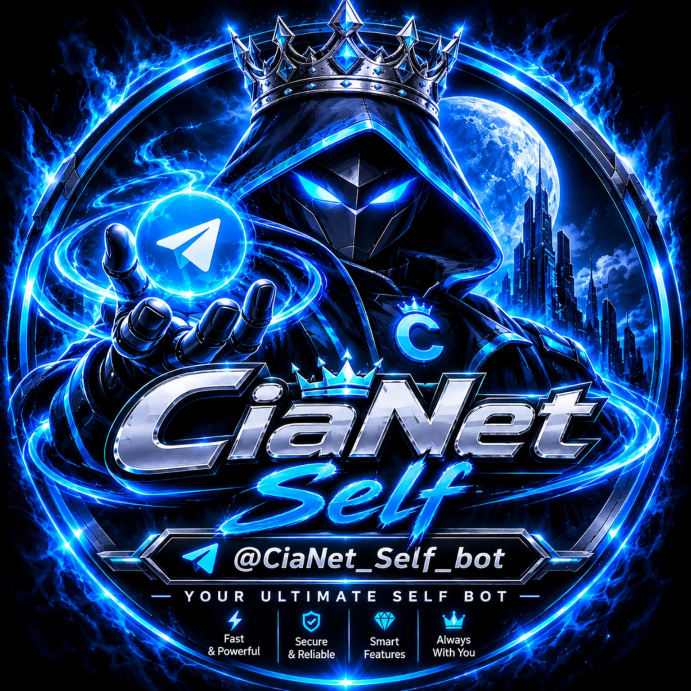
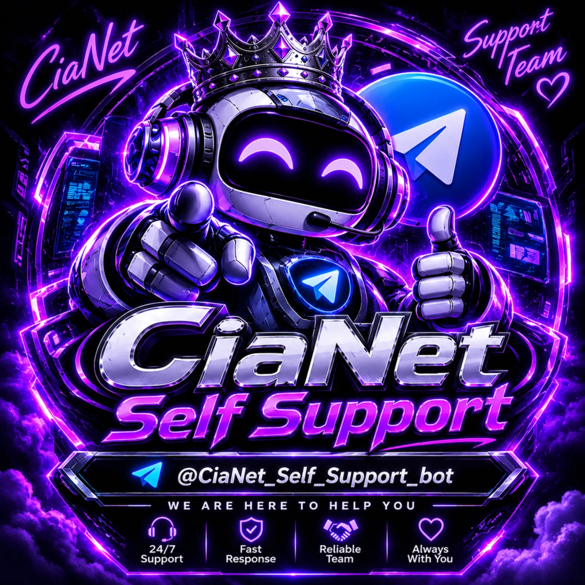

<div align="center">

# CiaNet Self

### Telegram Self-Bot SaaS · مستقل · 𝒗₁.₀

<p>
  
  &nbsp;&nbsp;
  
</p>

<p>
  
  
  
  
  
  
</p>

**هویت اختصاصی CiaNet Self · استقرار روی Amazon EC2 / VPS · بدون Railway**

[ربات اصلی](https://t.me/CiaNet_Self_bot) · [پشتیبانی](https://t.me/CiaNet_Self_Support_bot) · [کانال رسمی](https://t.me/CiaNet_Self) · [ارتباط مستقیم](https://t.me/sadiq_AFG1)

</div>

---

## هویت رسمی پروژه

| مشخصات | مقدار |
|---|---|
| نام محصول | **CiaNet Self** |
| نسخه | **𝒗₁.₀** |
| ربات اصلی | `@CiaNet_Self_bot` |
| ربات پشتیبانی | `@CiaNet_Self_Support_bot` |
| کانال رسمی | `@CiaNet_Self` |
| ارتباط پشتیبانی | `@sadiq_AFG1` |
| دامنه پنل | `https://cianet-self.duckdns.org` |
| سرور هدف | **Amazon EC2 / Linux VPS** |
| Railway | استفاده نمی‌شود |

## امکانات موجود در سورس

- مدیریت حساب‌ها و نشست‌های تلگرام با Telethon
- ربات اصلی مدیریت و ربات پشتیبانی با توکن‌های مستقل
- مدیریت اشتراک، لایسنس، سفارش، کیف پول، پرداخت، تخفیف و نمایندگی
- پنل وب مدیریت و پنل وب کاربران
- آمار، گزارش فعالیت، تیکت و اعلان‌ها
- ابزارهای فعلی مدیریت حساب، پاسخ خودکار، پیام زمان‌بندی‌شده و تنظیمات
- بکاپ و بازیابی دیتابیس، تنظیمات و نشست‌ها
- مدیریت نسخه، بررسی آپدیت و بازگشت به نسخه قبلی

> این انتشار با هدف تغییر هویت برند و آماده‌سازی استقرار انجام شده است؛ قابلیت محصولی جدیدی به منطق اصلی اضافه نشده است.

> در ZIP ورودی Telegram Mini App مستقل وجود ندارد؛ به Mini App لوگو یا قابلیت تازه‌ای اضافه نشده است. دو تصویر بالا لوگوی پروفایل ربات اصلی و ربات پشتیبانی و هویت تصویری مخزن GitHub هستند.

## استقرار روی Amazon EC2

### زیرساخت موردنیاز

- Amazon EC2 یا VPS لینوکسی با Ubuntu 22.04 / 24.04
- دسترسی SSH با کاربر دارای sudo
- دامنه `cianet-self.duckdns.org` که به IPv4 عمومی همان سرور اشاره کند
- فضای ذخیره‌سازی پایدار برای دیتابیس و نشست‌ها

### پورت‌های شبکه

| پورت | کاربرد | دسترسی |
|---|---|---|
| `22/tcp` | SSH | فقط IP مدیر |
| `80/tcp` | HTTP و اعتبارسنجی SSL | عمومی |
| `443/tcp` | HTTPS پنل | عمومی |
| `8000/tcp` | پنل داخلی | فقط `127.0.0.1`، هرگز عمومی نشود |

### نصب یک‌مرحله‌ای از ریشه بسته

ZIP را استخراج کن؛ فایل `install.sh` در ریشه بسته قرار دارد. سپس از همان مسیر اجرا کن:

```bash
sudo bash install.sh
```

نصب‌کننده سیستم‌عامل Ubuntu/Debian را بررسی می‌کند، وابستگی‌ها را نصب می‌کند، محیط Python می‌سازد، فایل‌های کد را به `/opt/cianet` کپی می‌کند و سرویس‌های systemd را ایجاد می‌کند.

پس از نصب دامنه و آماده‌شدن DNS، SSL را فعال کن:

```bash
sudo bash install_panel.sh cianet-self.duckdns.org
```

### ورود به پنل

- پنل مدیریت: `https://cianet-self.duckdns.org/app/login.html`
- پنل کاربران: `https://cianet-self.duckdns.org/u/login.html`

نام کاربری اولیه پنل `Admin` است. اگر هنگام نصب رمز خالی گذاشته شود، رمز اولیه `Admin` خواهد بود؛ این رمز عمومی و موقت است و باید پیش از قرارگرفتن پنل در دسترس عموم تغییر کند.

## ساختار ZIP و اجرای آسان

این انتشار در **یک فایل ZIP واحد** ارائه می‌شود و فایل‌های سطح اصلی پروژه، از جمله `install.sh`، `main.py` و `README.md` مستقیماً در ریشه ZIP قرار دارند؛ پوشه اضافه‌ای به نام نسخه دور همه فایل‌ها پیچیده نشده است.

چند پوشه داخلی مانند `cianet/`، `web_static/`، `tools/` و `versions/` عمداً حفظ شده‌اند. این‌ها پوشه‌های اضافی بسته‌بندی نیستند: کد Python از `cianet/` import می‌کند و صفحات پنل از `web_static/` خوانده می‌شوند. تخت‌کردن همه فایل‌ها در یک سطح، نام فایل‌های تکراری را با هم قاطی و مسیر importها و پنل را خراب می‌کند. برای اجرا فقط لازم است `sudo bash install.sh` را از ریشه اجرا کنی.

## اعتبارسنجی هویت در آپدیت GitHub

- مخزن باید از نسخه اختصاصی همین پروژه در حساب GitHub مالک ساخته شود.
- نصب از clone گیت، آدرس `origin` همان مخزن را در تنظیمات خصوصی سرور ثبت می‌کند.
- آپدیتر قبل از اعمال commit، فایل `BRAND.json` آن commit را بررسی می‌کند.
- اگر شناسه ثابت `brand_id: cianet-self` و محصول `CiaNet Self` وجود نداشته باشد، آپدیت رد می‌شود.
- اگر بسته از ZIP نصب شود و `.git` نداشته باشد، مسیر آپدیت Git فعال نیست؛ برای آپدیت از GitHub، ابتدا مخزن اختصاصی را clone و سپس نصب را از همان clone انجام بده.

نمونه‌ی آماده‌سازی و نصب از مخزن اختصاصی (پس از ساخت repository خودت در GitHub):

```bash
sudo apt-get update && sudo apt-get install -y git
git clone https://github.com/USERNAME/REPOSITORY.git
 cd REPOSITORY
 sudo bash install.sh
```

در این نمونه `USERNAME/REPOSITORY` را با نشانی مخزن خودت جایگزین کن. نصب‌کننده `origin` همان clone را به‌عنوان منبع مجاز آپدیت ثبت می‌کند.

این کنترل برای جلوگیری از برگشت تصادفی به سورس یا مخزن قبلی است؛ برای آنکه برند حفظ شود، commitهای آینده مخزن خودت هم باید `BRAND.json` معتبر را نگه دارند.

## تنظیمات محرمانه

اطلاعات API و توکن ربات‌ها داخل ZIP یا Git قرار نمی‌گیرند. نصب‌کننده آن‌ها را به‌صورت تعاملی دریافت و در فایل خصوصی `/etc/cianet.env` ذخیره می‌کند. مجوز فایل `600` است.

متغیرهای مهم:

- `API_ID` و `API_HASH`
- `ADMIN_BOT_TOKEN` و `HELPER_BOT_TOKEN`
- `ADMIN_ID`
- `PANEL_ADMIN_USER` و هش رمز پنل
- `PANEL_URL`
- `CIANET_SUPPORT_CONTACT` و `CIANET_CHANNEL`
- `CIANET_UPDATE_REMOTE` و `CIANET_BRANCH`

**توکن‌هایی که در گفتگو فرستاده شده‌اند افشاشده محسوب می‌شوند.** پیش از راه‌اندازی واقعی، توکن هر دو ربات را در BotFather باطل و دوباره صادر کن. API Hash ارسال‌شده را هم در نسخه عمومی قرار نده. هرگز فایل `/etc/cianet.env` را به GitHub push نکن.

## مدیریت سرویس‌ها

```bash
sudo systemctl status selfbot cianet-panel
sudo systemctl restart selfbot cianet-panel
sudo journalctl -u selfbot -f
sudo journalctl -u cianet-panel -f
```

## وضعیت بررسی

- بررسی سلامت آرشیو ZIP
- کامپایل ایستای فایل‌های Python
- بررسی نحو اسکریپت‌های Bash
- بررسی نحو JavaScript صفحات پنل
- بازبینی پیکربندی نصب و مسیر آپدیت GitHub
- بررسی وجود لوگوی اصلی و لوگوی پشتیبانی در ریشه مخزن

**محدودیت:** این بسته از داخل گفتگو روی سرور AWS واقعی نصب نشده است؛ اجرای زنده، اتصال ربات‌ها، پرداخت‌ها و SSL باید روی EC2 واقعی پس از واردکردن اعتبارنامه‌های جدید بررسی شوند.
